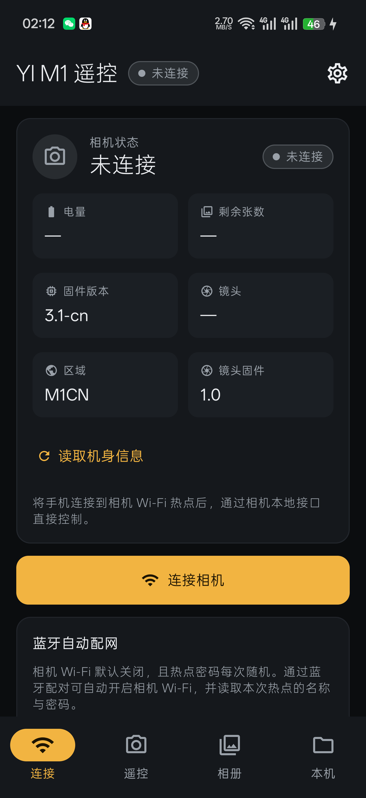

# 小蚁 M1 遥控 / YI M1 Remote

一个用 Android 手机连接 **小蚁 YI M1 微单相机** 的本地遥控与照片管理 App。官方云服务停止后，相机仍可通过自带的 Wi-Fi 热点和蓝牙使用；本项目直接与相机本地接口通信，不依赖任何服务器。

> **非官方项目**：与 YI Technology / 小蚁科技无隶属或授权关系。仅在官方固件上做互操作研究，不包含、不修改官方固件，也不提供刷机方案。

[](https://developer.android.com)
[](https://kotlinlang.org)
[](LICENSE)

## 功能

* **连接与配网**：连接相机热点；蓝牙自动配网（开启相机 Wi-Fi、读取本次 SSID/密码）；蓝牙对时；记住相机。
* **实时取景**：低延迟 UDP 取景，状态栏显示电量百分比、剩余张数、镜头状态；取景中断提示与重连。
* **对焦**：点击画面对焦（点选），或切换「区域：自动」由相机选择对焦区域；橙色=对焦中、绿色=成功、红色=失败。
* **完整曝光控制**：P/A/S/M/C、快门、光圈、ISO、EV、白平衡、色彩、测光、驱动模式、张数、格式/画质/画幅等。
* **取景辅助**：峰值对焦、高光斑马纹、九宫格、水平仪、直方图；客户端 EV 亮度模拟（明确标注为模拟）。
* **曝光检查**：M 档取景不模拟曝光，App 可用「曝光检查」拍一张试拍并分析亮度/高光/暗部，给出建议。
* **间隔拍摄 / 曝光包围（BKT）**：相机端间隔命令在 3.1 固件不可用，由 App 端定时触发；BKT 按相机 EV 选项表逐张包围并恢复原参数。
* **拍摄与下载**：遥控快门；相册浏览、RAW/JPG 下载；RAW 缩略图与预览（相机 Thumbnail/MidThumb）；视频下载。
* **照片详情**：EXIF 面板（相机/手机 UTC 时间、尺寸、大小、光圈、快门、ISO、焦距、镜头等）；RAW 快速预览。
* **本机相册**：已下载照片的浏览、分享、旋转保存、删除、多选。
* **机身信息**：通过 BLE `41106da2` 读取并显示机身固件、区域、镜头固件（例：3.1-cn / M1CN / 1.0）。



## 下载安装

* **签名 APK**：[`dist/YI-M1-Remote-1.0.8-release.apk`](dist/YI-M1-Remote-1.0.8-release.apk)
* SHA-256：`72E886755DADF326D18D715C3B059A45C2F5038D03F34B39E9416788EB14AB8C`
* 签名证书 SHA-256：`AB:8D:95:C2:7A:12:2F:1B:F9:CD:94:F7:39:EB:F7:41:91:88:C9:CC:8E:73:80:0E:AA:EE:FA:03:F1:DD:CE:B8`
* 要求：Android 9（API 28）及以上；手机需支持 Wi-Fi 与蓝牙（BLE 配网可选）。

> **升级注意**：从 **1.0.8** 起使用独立的发布签名证书。如果你装过以前的 debug 签名版本，需要先卸载旧版再安装（否则会提示签名不一致）；本地数据/已下载照片在公共相册中不受影响。

也可以从 [GitHub Releases](https://github.com/rinano/yim1-m1-remote/releases)下载同一 APK。

## 快速使用

1. 相机开机，插入 SD 卡；需要时在相机菜单开启 Wi-Fi/蓝牙。
2. 手机连接相机热点（默认 `YI_M1_...`，密码可用 App 蓝牙配网读取，或相机屏幕查看）。
3. 打开 App →「连接」→「连接相机」。
4. 「遥控」页：取景、对焦、调参、拍摄；「相册」下载照片；「本机」管理已下载照片。

更详细说明见 [用户指南](docs/USER-GUIDE.md)。

## 构建

需要 **JDK 17**、**Android SDK Platform 35 + Build-Tools 35.0.0**。

```bash
# Debug
./gradlew assembleDebug

# Release（需要 keystore.properties，见下）
./gradlew assembleRelease
```

`keystore.properties`（放在仓库根目录，已在 `.gitignore` 中）：

```properties
storeFile=/absolute/path/to/your-release.jks
storePassword=***
keyAlias=yim1remote
keyPassword=***
```

没有该文件时 release 构建会自动退回 debug 签名，方便贡献者本地安装测试；发布 APK 请使用自己的 release key。

测试：

```bash
./gradlew testDebugUnitTest
```

## 项目结构

```text
app/src/main/java/com/yim1remote/app/
  data/        # 相机 HTTP/UDP 协议、BLE 配网、下载、配置
  ui/          # Compose 界面：连接/遥控/相册/本机
  ui/vision/   # 峰值、斑马纹、直方图、水平仪、曝光检查
  ui/media/    # 本机相册/查看器
docs/          # 协议、用户指南、测试与逆向说明
dist/          # 已签名发布 APK
keystore/      # 发布证书（仅公钥）
```

## 协议与逆向说明

* 相机 HTTP API 与 UDP 取景格式来自对官方 App 的互操作分析与公开社区研究；本项目**不包含官方 APK、反编译产物或固件**。
* 详细协议、实测结果和限制见 [docs/PROTOCOL.md](docs/PROTOCOL.md)、[docs/REVERSE-ENGINEERING.md](docs/REVERSE-ENGINEERING.md)。
* 参考的公开研究/项目：
  * [zeroa234/XIAOYI_M1](https://github.com/zeroa234/XIAOYI_M1) — YI M1 固件研究（不包含可安全刷写的固件）
  * [bullbin/xiaoyi_m1_re_liveview](https://github.com/bullbin/xiaoyi_m1_re_liveview) — BLE/Wi-Fi 取景参考实现
  * [echeetah/yi-m1-monitor](https://github.com/echeetah/yi-m1-monitor) — 第三方监看 App
  * [protyposis/yi-mirrorless-firmware-tools](https://github.com/protyposis/yi-mirrorless-firmware-tools) — 固件拆包工具（仅研究用途）

## 已知限制

* 相机 Wi-Fi 下载约 **1.8 MB/s**，瓶颈在相机端；传 30 MB RAW 约 18 秒；换更快 SD 卡不会明显提速。
* 3.1 固件拒绝相机端间隔/BKT 命令（HTTP 404），间隔与包围由 App 端实现，需保持 App 前台。
* M 档取景亮度不随曝光变化是相机固件限制；「曝光检查」用试拍评估。
* 官方固件存在随机挂死报告；本项目不修改固件，不做稳定性补丁。
* 相机 USB 大容量存储与遥控模式互斥，开遥控后 USB 可能掉线，需拔插。

## 免责声明

本项目仅用于个人学习与互操作研究，按“现状”提供，不保证相机/数据安全。使用风险由使用者自行承担。请勿将本项目用于修改、破解或重新分发官方固件；不要刷写来源不明的固件。

## 许可证

App 源代码采用 **MIT License**，详见 [LICENSE](LICENSE)。协议研究文档中的第三方信息、商标和相机固件权利归各自所有者。截图仅用于展示 App 界面。

---

## English summary

An unofficial Android remote-control and gallery app for the **YI M1 mirrorless camera** (Xiaoyi). It talks directly to the camera's local Wi-Fi HTTP/UDP API and BLE provisioning service; no cloud service is required. Features include live view, tap/auto-area focus, full exposure controls, focus assists (peaking/zebra/grid/level/histogram), M-mode exposure check, app-side interval shooting & EV bracketing, RAW/JPG download, EXIF viewer, local album and camera firmware/region info.

Download: [`dist/YI-M1-Remote-1.0.8-release.apk`](dist/YI-M1-Remote-1.0.8-release.apk). Requires Android 9+. Not affiliated with YI Technology. Source is MIT-licensed; no official APK or firmware is included.
